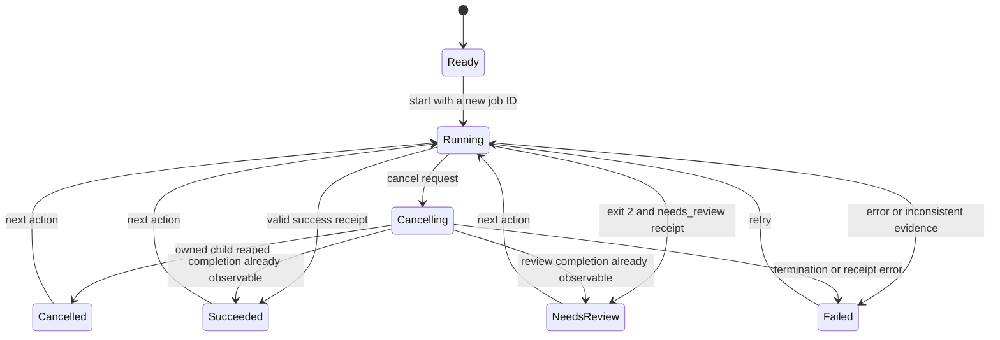
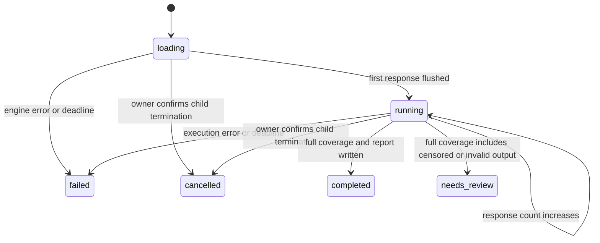

# Abliteration Studio state-machine audit

This audit covers the native Rust Studio, its companion CLI and research library, and the application-owned state at their handbook and delivery boundaries. It does not claim to enumerate the internals of Iced, Tokio, mistral.rs, the operating system, or the historical Python/C++ research examples.

The decision is to make **workflow state explicit where contradictory states can mislead a person or an automation**, while retaining simple independent choices and already explicit contracts. No state-machine framework or new runtime dependency is required. The model, frozen protocol, benchmark exclusions, and existing CLI exit codes stay compatible.

## Native application inventory

| ID | Machine and source | States / triggers | Decision |
| --- | --- | --- | --- |
| N01 | [Studio operation](../rust/lab/src/lifecycle.rs) and [message handling](../rust/lab/src/studio_ui.rs) | Ready → running → cancelling or settled; job completion, local validation, retry | Replace `busy` plus `error` and inferred cancellation with `Session`, `Operation`, and `Outcome`. Only the matching job ID may complete the current operation. |
| N02 | [Owned child lifecycle](../rust/lab/src/studio_ui.rs) | Not spawned → spawned → exiting → reaped; cancellation / application shutdown | Check cancellation before spawning. Drain both pipes while waiting. Normal cancellation kills through the owned child handle and waits for termination before admitting new work. Completion wins if already observable. `kill_on_drop` remains a shutdown fallback. |
| N03 | Checkpoint readiness in [Studio](../rust/lab/src/studio_ui.rs) | Unchecked → checking → verified / failed; edit path or cancel → unchecked | Replace the verification boolean with `Readiness`. Starting a re-check removes the old verified label. Failure cannot retain old trust. |
| N04 | Protocol readiness in [Studio](../rust/lab/src/studio_ui.rs) and [CLI](../rust/lab/src/bin/cli.rs) | Unchecked → preparing or checking → verified / failed | Add read-only `verify-protocol` and **Verify existing** so a prepared protocol can be reused without downloading or recreating it. GUI admission requires both verified inputs. CLI `run` continues to verify inputs itself. |
| N05 | [Configuration draft](../rust/lab/src/config.rs) | Editable text → parsed / invalid → executable or reference-only; active jobs lock changes | Retain the typed `RunConfig` validator. All run-relevant edits clear the displayed result and old completion notice. RefusalBench remains excluded from execution. |
| N06 | [Loaded result](../rust/lab/src/studio_ui.rs) | No result → loading/verifying → completed or needs-review result; new draft / failed new load clears it | Associate displayed evidence with its run path. Distinguish needs-review visibly. Require exit `0` + `completed`, or exit `2` + `needs_review`; inconsistent combinations fail. |
| N07 | [Configuration/output reservation](../rust/lab/src/studio_ui.rs) and [fresh directory](../rust/lab/src/protocol.rs) | Absent → created; existing matching config → reused; existing differing config/output → rejected | Keep exclusive creation and immutable run directories. A retry uses a new run folder; it must not destroy partial evidence. |
| N08 | [Model download](../rust/lab/src/model.rs) | Missing → partial → digest checked → promoted; existing verified file → reused; mismatch → rejected | Retain per-file hash verification and temporary files. Existence alone is not readiness. An interrupted download is not a verified checkpoint. |
| N09 | [Protocol preparation](../rust/lab/src/protocol.rs) | Fetch → source hash / row validation → serialization → fresh directory → data + pin publication | Retain the frozen-content contract. `verify-protocol` independently validates both files before reuse. Partial directories are not certified. |
| N10 | [Engine construction](../rust/lab/src/engine.rs) | Configuration checked → backend/device available → model loaded → generation; unsupported device / generation error | Retain the constructor's `Result` and explicit device/precision choice. Do not turn a CUDA failure into an unreported CPU-only run. |
| N11 | [Evaluation phase](../rust/lab/src/evaluation.rs) | Loading → calibration generation → selection committed → held-out generation → model re-check → report | Retain calibration-before-test ordering and immutable selection evidence. These phases are separate from whether an operating-system process is alive. |
| N12 | [Run progress](../rust/lab/src/lifecycle.rs) | Loading → running → completed / needs_review / failed / cancelled | Typed monotonic counters and terminal transitions. Publish whole JSON snapshots by sibling-file replacement. Errors and deadlines publish terminal progress and a stable failure kind. |
| N13 | [Evidence certification](../rust/lab/src/evidence.rs) and [metrics](../rust/lab/src/metrics.rs) | Missing/partial/mismatched → rejected; complete coherent evidence → verified; invalid output → unmeasurable rate | Hash and validate the same bounded byte snapshots. Bind a displayed verified report to the verifier's receipt, rejecting a changed file. Process success, report integrity, and scientific usefulness remain distinct. Existing reports stay readable. |
| N14 | [Navigation and appearance](../rust/lab/src/studio_ui.rs) | `Page` enum; light/dark selection | Keep orthogonal UI choices. Navigation remains usable during a job; it must not start or cancel model work. |
| N15 | [Window shutdown](../rust/lab/src/studio_ui.rs) | Open → waiting for child → exit requested | Intercept normal close requests. Closing cancels the owned job, rejects new work, and exits after its matching completion. Stale callbacks cannot close a newer job. Forced process termination still relies on the shutdown fallback and may leave incomplete receipts. |

## Adjacent handbook and automation inventory

These are separate entry points, not hidden dependencies of the native job machine. Their state is inventoried here; this change does not rewrite the historical web interface or research methods.

| ID | Boundary and source | Observed representation / states | Decision |
| --- | --- | --- | --- |
| B01 | [Handbook search](../src/handbook/HandbookApp.tsx) | Dialog open/closed; index absent/loading/loaded/fallback; abort on close | Keep scoped to the reader. A future reader-specific change should consolidate loading/fallback and reject late fetch completions; do not couple it to native job state. |
| B02 | [Routing](../src/lib/handbook-routing.js), [reader](../src/handbook/HandbookApp.tsx), [navigation](../scripts/lib/browser-navigation.mjs) | Canonical route / missing route; navigation pending / settled; initial document / hydration | Keep URL and route data authoritative. Native operation state must not decide browser routing. |
| B03 | [Reader persistence](../src/handbook/HandbookApp.tsx) and [learning steps](../src/components/step-guide.tsx) | Unloaded → restored/default; bookmark/checkpoint toggles → persisted or storage failure | Separate in-memory success from persistence success. Existing storage keys remain untouched. |
| B04 | [Reader preferences and diagram viewer](../src/handbook/HandbookApp.tsx) | Wrap/density, active heading, search overlay, diagram absent/open, zoom | Retain independent preferences and derived scroll position. A giant combined state machine would make unrelated controls harder to maintain. |
| B05 | [Clipboard workbench](../src/components/cli-workbench.tsx), [research explorer](../src/components/research-explorer.tsx), [reader](../src/handbook/HandbookApp.tsx), [historical lab](../src/components/selective-lab.tsx) | Idle → copy pending → copied/error → notice reset; text/selection can change meanwhile | Inventory-only web concern. Future consolidation should key copy completion and timer expiry to the copied text/request, handle denied clipboard access, and clean up timers. |
| B06 | [Research filtering](../src/components/research-explorer.tsx), [techniques](../src/components/technique-explorer.tsx), [result selector](../src/components/research-results.tsx) | Query, area, snapshot, expansion, comparison IDs, cohort/run selection | Keep data-derived filtering and independent selections. These controls do not execute experiments. |
| B07 | [Path finder](../src/components/path-finder.tsx), [method radar](../src/components/method-radar.tsx), [lessons](../src/handbook/lessons.tsx) | Hardware/architecture/commitment or method selection; illustration controls | Keep finite choices and pure derived recommendations. They are not execution readiness evidence. |
| B08 | [Evaluation gates](../src/components/evaluation-gates.tsx) and [historical selective lab](../src/components/selective-lab.tsx) | Editable illustrative metrics and selections → derived gate / command preview | Preserve their separate illustrative scope. Do not promote a simulated state to an executed native result. |
| B09 | [Web appearance](../src/components/theme-toggle.tsx), [header](../src/components/site-header.tsx), [UI primitives](../src/components/ui/dialog.tsx) | Theme, scroll-derived presentation, library-owned open/closed/focus states | Keep library and component ownership; no duplicate application-wide flags. |
| B10 | [Native packaging](../rust/scripts/package.ps1), [archive verification](../rust/scripts/verify-package.ps1) | Built → identity checked → staged → manifested → archived → fresh extraction verified | Keep source commit, executable digest, target, and archive hash as separate gates. Artifact existence is not success. |
| B11 | [Rust CI/release](../.github/workflows/rust-studio.yml) | Triggered → contract gate → platform jobs → CUDA qualification → attestations → versioned publication | Add a backend-independent contract gate for earlier feedback; retain the full platform and release gates. A pending or cancelled job is not a passing qualification. |
| B12 | [Handbook preparation/deployment](../scripts/prepare-handbook.mjs), [Pages workflow](../.github/workflows/pages.yml) | Prepared → rendered → audited → uploaded → deployed → live audited | Keep build, publication, and live acceptance distinct. HTTP availability alone does not prove the right source was deployed. |
| B13 | [Ralph backlog](../data/ralph-backlog.json), [continuation](../scripts/ralph-autostart.mjs), [turn-end](../scripts/ralph-turn-end.mjs) | Pending/in_progress/done; enabled/disabled; signal queued; daemon absent/alive/stale | Preserve backlog authority and process ownership. `--log-only` records work without starting background continuations. |

## Operation contract

`Operation::Settled` carries an `Outcome`; the diagram expands those outcomes for readability. Status text is presentation, never a control-flow input.



An old callback is ignored, including after cancellation followed by a new action. A second start cannot replace an active job. Repeated cancellation is a no-op. A local notice cannot unlock an active job. Changed draft inputs clear displayed results while preserving saved run files.

The evidence summary is derived from the operation and loaded report: running, stopping, checking, review, recorded, or no result. It does not label an active or interrupted operation as “not run.” Input readiness records the latest successful check of the selected path; it is not a live filesystem monitor, and the CLI rechecks input bytes before every evaluation.

## Durable run contract for agents



`progress.json` retains `status`, `completed`, `total`, and `pid`. Existing `loading`, `running`, `completed`, and `needs_review` values are preserved; terminal `failed` and `cancelled` snapshots prevent normal failures and owned cancellations from appearing indefinitely active. `failure.json` keeps `status: "failed"` and adds `kind: "execution_failed"` or `"deadline_exceeded"`. CLI success remains exit 0, review-required results remain exit 2, and errors remain nonzero.

Terminal states cannot resume, counters cannot regress or exceed coverage, and partial runs cannot become completed reports. Cancellation receipts require the matching run identity and process ID, and do not overwrite already terminal progress. The supervisor retains the actual process handle; the PID in a JSON file alone never authorizes termination.

A forced external kill, power loss, or unwritable filesystem can still prevent a final receipt. Treat an abandoned active snapshot as **unknown/interrupted**, not successful and not permission to kill a process with a reused PID. `identity.json`, process ownership, exit status, and report integrity answer different questions. `verify-report` remains the authority for certifying saved evidence; progress alone is never a benchmark score.

Agents can preflight a previously prepared protocol without mutation:

```bash
./abliteration-cli verify-protocol /path/to/protocol/protocol.jsonl
./abliteration-cli verify-report --run /path/to/run --protocol /path/to/protocol/protocol.jsonl
```

## UX, DX, and AX decision record

| Change | UX | DX | AX |
| --- | --- | --- | --- |
| One operation state and job identity | No phantom cancellation or stale completion | Exhaustive action/outcome matches and testable transitions | A callback cannot silently change ownership of work |
| Explicit readiness and protocol reuse | Failed checks clear old verified labels; existing cohorts are reusable | Shared readiness semantics; one native protocol validator | Read-only preflight returns structured pinned evidence |
| Result invalidation and review distinction | Old results do not masquerade as the edited draft | Strict exit/evidence classification | Contradictory receipts fail rather than becoming success |
| Atomic terminal progress and failure kinds | Failure/cancellation has a truthful endpoint | Transition guards localize lifecycle rules | Pollers receive complete JSON and stable outcome/reason fields |
| Owned cancellation and retained artifacts | Retry waits for the previous child to stop | No process-name killing or shell dependency | Ownership and artifact validity remain independently auditable |

Regression coverage includes stale callbacks, double starts/cancels, both-input admission, failed re-verification, draft/result invalidation, inconsistent exit/report pairs, deadline/error receipts, partial completion rejection, ownership checks, terminal preservation, and cancellation of an actual owned test process. No RefusalBench execution is part of this audit or its tests.

The cheap inner loop is `cargo test --locked --release --no-default-features --lib`. CI runs it before platform builds; the full GUI-enabled suite still tests reducer integration and real child termination. Normal window closing also waits for the current child and rejects new work while waiting.
